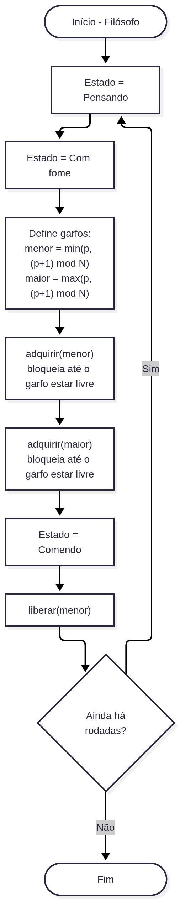

# TDE-PFSC
Davi BAista & Enzo Bortolozzo Borges

# Video Youtube

https://youtu.be/AecwWq8B_tY

# *-Parte 1 - Filosofos*

No jantar, cada filosofo precisa de 2 talheres para comer, e cada talher é dividido com um vizinho, no ingênuo todos pegam o garfo da esquerda primeiro, e depois o da direita, se todos ficarem com fome juntos pegam primeiro o garfo da esquerda, e ficam esperando o da direita, que ja esta ocupado, a solução foi fazer com que o filosofo 4 pegue primeiro o garfo 0 antes do 4, assim por nenhum filosofo segurar o garfo de indice maior esperando o de menor, sempre tem alguem com dois garfos.

Versão com deadlock: src/parte 1-filosofos/problema com deadlock.py

Versão sem deadlock: src/parte 1-filosofos/problema sem deadlock.py

# *-Parte 2 - Semaforo*

# *-Parte 3 - deadlock*

